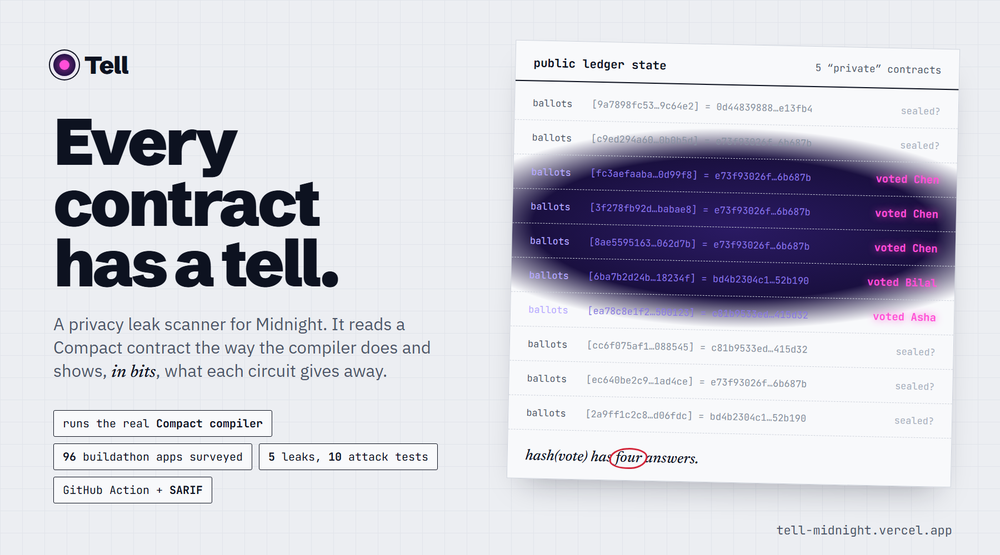

<p align="center"></p>

<p align="center">
  <a href="https://github.com/RohanGlitched/tell/actions/workflows/ci.yml"></a>
  <a href="LICENSE"></a>
  
  
</p>

<p align="center">
  <b><a href="https://tell-midnight.vercel.app">Live site</a></b> ·
  <b><a href="https://tell-midnight.vercel.app/scan">Scan a contract</a></b> ·
  <b><a href="https://tell-midnight.vercel.app/survey">Buildathon survey</a></b> ·
  <b><a href="https://tell-midnight.vercel.app/zoo">Leak zoo</a></b> ·
  <b><a href="https://tell-midnight.vercel.app/live">Live on Midnight</a></b> ·
  <b><a href="https://tell-midnight.vercel.app/how">How it works</a></b>
</p>

Midnight keeps a contract's private inputs off the chain. What the contract does with them can still give them away: a hash of a vote, a branch on a balance, the same tag on every post. **Tell** reads a Compact contract the way the compiler does and shows, in bits, what each circuit tells the world. It runs in the browser, on the command line and as a GitHub Action, and it has already been run over every public app in the Midnight Buildathon.

Built for the [Midnight Buildathon](https://app.akindo.io/wave-hacks/jaMZjqPOBsLXvjdG), Wave 2, October 2026.

## Doesn't the compiler already check this?

Half of it. Compact makes you write `disclose()` wherever private data may reach the ledger. That answers *whether* something goes public. It cannot say *how much* it gives away, and that is where every leak in the survey lives.

| This line | Compiler | Tell |
|---|---|---|
| `disclose(hash(vote))` | accepted | 8 bits; four guesses recover it |
| `disclose(hash(id, salary))` | accepted | `id` is public in the same call; the salary falls to brute force |
| `if (disclose(bid >= reserve)) a.insert(t) else b.insert(t)` | accepted | which set was written shows the bid's side |
| `posts.insert(n, disclose(hash(key)))` | accepted | the same tag on every post: one identified post unmasks all |
| `owner = disclose(degradeToTransient(sk))` | accepted | a cast, not a hash: the key is on the ledger |

Tell starts where `disclose()` stops. It works on the compiler's own output, so it complements the compiler instead of competing with it, and could run as one of its passes.

## What it finds

| Finding | Severity | Example |
|---|---|---|
| Guessable hash | critical / high | `ballots.insert(tag, persistentHash(choice))` after `assert(choice < 4)`: 2 bits, four guesses |
| Secret in the clear | critical / high | `owner = disclose(secretKey())`; a value hashed as a key in one circuit and written raw in another; a secret returned from a circuit |
| Secret-dependent branch | medium | writing `qualified` or `belowReserve` depending on a hidden bid; count leaks in fixed-size loops |
| Same tag on every action | medium | every post stores `hash(memberKey)`, so one identified post unmasks the rest |
| Wallet key published | medium | a user's `ownPublicKey()` stored in a record ties all their activity to one wallet |
| Private bytes or personal data in the clear | medium | a seed or private key written as-is; a salary or a location written to a map |
| Linkable tag | low / info | the same `hash(sk)` in register, commit and reveal |
| Published value / yes-no fact | info | values written on purpose, listed so nothing is hidden |

Grades run from A (nothing above info) to F (anything critical). Severity follows what is revealed; names only adjust it at the edges (officer fields, personal data, key material):

- `assert(x < N)` bounds a value to log2(N) bits, so a vote among four candidates is 2 bits, whatever its type.
- Circuit arguments are as private as witnesses in Compact, but usually carry public inputs, so they rank one step lower; a hash of a small argument is still high. An argument the source writes as `disclose(arg)` is public on purpose.
- A branch is not reported when both paths run the same operation, when the value is published anyway, or (as low) when nothing in the circuit identifies the caller: a public tally of anonymous votes.
- Officer keys set once (`owner`, `authority`) and access checks against them are low: that is the usual admin design.

## How it works

1. **Runs the real Compact compiler** with `--trace-passes --skip-zk`, matched to the contract's `pragma`, preferring 0.31.1 (the ledger live today) and falling back through 0.35, 0.34, 0.30 and 0.29.
2. **Reads the compiler's own `reduce-to-circuit` form**: helpers inlined, loops unrolled, every step a guarded binding. Older compilers print a different shape; Tell normalises both.
3. **Traces every witness result and circuit argument** through hashes, commitments, casts, comparisons, struct fields and branches to every public ledger operation, keeping count of how many unknown bits survive.
4. **Grades and reports** as text, JSON or SARIF, with the line, the fix and the public transcript of each circuit.

## Evidence

- **Leak zoo** ([`zoo/`](zoo)): five leaky contracts and their fixes. Each leak is carried out by an attack test that reads the secret back out of public ledger state; each fix stops it. Ten attack tests in CI.
- **Precision tests** ([`engine/test`](engine/test)): 83 tests. Every zoo leak is reported exactly once, nothing above low on the fixes, regression cases from review, and findings in Midnight's own examples (the election example reveals votes through a branch; the zk-loan example publishes predicates).
- **Survey** ([`engine/scripts/survey.ts`](engine/scripts/survey.ts), results in [`web/data/survey.json`](web/data/survey.json)): every public repository linked from the buildathon on AKINDO: 111 repositories, 365 contracts found, 248 compiled with the compiler each one's pragma asks for, 96 projects analysed circuit by circuit. Every medium-or-worse finding was read by hand against the source. Results are published in aggregate under salted numbers; no team is named, and findings are for the team concerned.
- **Live on Midnight** ([`chain/`](chain)): the leaky and fixed ballots deployed on Midnight Preprod with the same votes. The site reads both from the indexer and runs the attack Tell predicted.

## Run it

```bash
compact update 0.31.1
npm install
npx tsx engine/src/cli.ts path/to/contracts                      # readable report
npx tsx engine/src/cli.ts . --json                               # machine-readable
npx tsx engine/src/cli.ts . --sarif tell.sarif --fail-on high    # for CI
```

### In CI

```yaml
- uses: RohanGlitched/tell@v1
  with:
    path: contract
    fail-on: high
```

Findings appear in GitHub code scanning on the line that leaks. Some disclosures are the point; mark them once and Tell stops reporting them:

```compact
seeds.insert(slot, s); // tell:allow secret-published
```

## Who it is for

- **Midnight developers**: findings land on the pull request, before a contract is deployed and its history is public forever.
- **Auditors and reviewers**: a map of every disclosure, in bits, per circuit and field; where to look first, and evidence for the report.
- **The people using these apps**: their votes, salaries, locations and identities are what these contracts hold. Tell needs none of that data; it reads only source code and public state.

## Where it goes next

| When | What |
|---|---|
| Now | Scanner, CLI, GitHub Action with SARIF, leak zoo with attack tests, survey of every buildathon app, live demo on Preprod |
| Wave 3 | Pull request comments with the fix inline; constructor and return-value analysis; shielded token and DUST patterns in the zoo |
| Next | A VS Code extension that marks leaking lines as you type; a Tell check in Midnight's project templates |
| Later | Hosted checks with history per contract, team dashboards, and a privacy report auditors can attach |

The CLI, the Action, every rule and the leak zoo stay free and open source (Apache-2.0). On other chains, analyzers are kept alive by audit work (Slither, Aderyn), ecosystem grants (Certora) or by joining the chain's toolchain (Move Prover); hosted-only analysis has the weakest record (MythX was shut down). Tell follows that pattern, in this order:

1. **An ecosystem tooling grant** pays for rule research and for tracking each compiler release.
2. **Audit firms** use Tell's per-circuit disclosure map as the privacy section of a Compact review.
3. **The compiler**: Tell reads the compiler's own output, and running as one of its passes is the goal.
4. **Production teams, later**: history and dashboards for private repositories once mainnet has the teams for it; public repositories stay free.

What exists today: the compiler checks *whether* data is disclosed; OpenZeppelin's Compact security detectors check loop bounds and assertion messages. Nothing else measures *how much* a disclosure gives away.

## Layout

| Path | What |
|---|---|
| [`engine/`](engine) | analyzer, CLI, SARIF output |
| [`zoo/`](zoo) | leaky and fixed contract pairs, attack tests |
| [`web/`](web) | the website: scanner, survey, zoo, live demo (Next.js) |
| [`chain/`](chain) | house wallet and deploy scripts for Midnight Preview and Preprod |
| [`action.yml`](action.yml) | the GitHub Action |

## Limits

Tell is static analysis of what the compiler builds. It reports what the public transcript *can* reveal, not proof that anyone has read it. It does not yet analyse constructors, and outside `assert` bounds and personal-data names it estimates brute-force cost from types, not from the real distribution of values. See [what Tell cannot see](https://tell-midnight.vercel.app/how#limits).

## License

Apache-2.0
