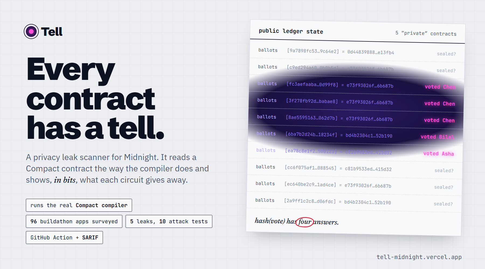

<p align="center"></p>

<p align="center">
  <a href="https://github.com/RohanGlitched/tell/actions/workflows/ci.yml"></a>
  <a href="LICENSE"></a>
  
  
  
</p>

<p align="center">
  <b><a href="https://tell-midnight.vercel.app">Live site</a></b> ·
  <b><a href="https://tell-midnight.vercel.app/scan">Scan a contract</a></b> ·
  <b><a href="https://tell-midnight.vercel.app/wave3">Wave 3: you said, we did</a></b> ·
  <b><a href="https://tell-midnight.vercel.app/desk">Tell Desk</a></b> ·
  <b><a href="https://tell-midnight.vercel.app/teams">Who it's for</a></b> ·
  <b><a href="https://tell-midnight.vercel.app/adoption">Adoption</a></b> ·
  <b><a href="https://tell-midnight.vercel.app/zoo">Leak zoo</a></b> ·
  <b><a href="https://tell-midnight.vercel.app/survey">Survey</a></b> ·
  <b><a href="https://tell-midnight.vercel.app/live">Live on Midnight</a></b> ·
  <b><a href="https://tell-midnight.vercel.app/how">How it works</a></b> ·
  <b><a href="https://youtu.be/UXauGr1tmhI">Demo video (Wave 2)</a></b> ·
  <b><a href="docs/tell-deck.pdf">Deck (Wave 2)</a></b>
</p>

Midnight keeps a contract's private inputs off the chain. What the contract does with them can still give them away: a hash of a vote among four candidates, a branch on a hidden bid, the same tag on every post. The compiler's `disclose()` check says *whether* private data reaches the public ledger; **Tell** says *how much*. It runs the real Compact compiler, reads the compiler's own circuit form, traces every private input to every public ledger operation, event and contract call, and reports, per circuit, how many bits each one gives away, with the line and a fix it has compiled and checked. It runs in the browser, on the command line, as a GitHub Action that reviews pull requests, in VS Code and inside coding agents. Wave 3 adds Tell Desk, a Compact contract on Midnight Preprod for private, provable disclosure of the leaks Tell finds and an on-chain registry of its grades.

Built for the [Midnight Buildathon](https://app.akindo.io/wave-hacks/jaMZjqPOBsLXvjdG) on AKINDO: Wave 2 (October 2026, 20 points) and Wave 3 (November 2026).

**Contents:** [Wave 3: you said, we did](#wave-3-you-said-we-did) · [What changed since Wave 2](#what-changed-since-wave-2) · [Try it](#try-it) · [What it finds](#what-it-finds) · [How it works](#how-it-works) · [Tell Desk](#tell-desk-disclosure-and-grades-on-midnight) · [Tell and MPS-0036](#tell-and-mps-0036) · [Radar](#radar-reading-the-chain-without-the-source) · [How Tell compares](#how-tell-compares) · [Evidence](#evidence) · [Who it's for and who pays](#who-its-for-and-who-pays) · [Repository layout](#repository-layout) · [Setup and tests](#setup-and-tests) · [Limits](#limits) · [Roadmap](#roadmap) · [License](#license-and-attribution)

## Wave 3: you said, we did

Every point from the Wave 2 review (jkato, October 30) and the recap sent to all teams, what we changed, and where to check it. Status is as of November 7, 2026. [/wave3](https://tell-midnight.vercel.app/wave3) has the same points with the same statuses, kept current.

| You said | What we did | Evidence | Status |
|---|---|---|---|
| "Deploy to testnet and add the contract address to your README" | The leaky and fixed ballots are on Midnight Preprod with six real votes each, and the new Tell Desk contract is deployed there too. Every address and transaction is in this README. | [Live contracts](#live-contracts-on-midnight-preprod), [/live](https://tell-midnight.vercel.app/live) | done |
| "genuine private state with implemented witnesses and a commitment/hash" | A second contract where private state carries the design: Tell Desk seals a finding as a commitment, maintainers answer with a zero-knowledge Merkle membership proof, and nothing about the report, the project or either party is public until the reveal. Every `disclose()` is justified in a table. | [Tell Desk](#tell-desk-disclosure-and-grades-on-midnight), [`desk/`](desk) | in progress (deployed; demo lifecycle partly run) |
| "Genuinely interesting ecosystem tool, but as a business it is small." | We researched who pays and why now, wrote it down with sources, asked two audit firms for pilot talks (November 7), and opened public issues for 11 teams and one on Midnight's own examples. No revenue yet. | [Who it's for and who pays](#who-its-for-and-who-pays), [/teams](https://tell-midnight.vercel.app/teams) | in progress |
| "Your real substitutes are the Compact compiler itself and manual review by security firms" | The compiler answers *whether*, Tell *how much*, from the compiler's own output. Audit firms are buyers, not rivals: Tell's per-circuit map is the first day of a privacy review. We also measured Tell against every other Compact analyzer we could find. | [How Tell compares](#how-tell-compares), [`bench/RESULTS.md`](bench/RESULTS.md) | done |
| "the closest Web2 analogues (Slither, Semgrep, Snyk) are free or sold per developer seat" | Free like them, but not sold per seat: Midnight has about 150 active developers a month, too few for seats. The analyzer stays free and open source; money comes from audit-firm licenses and an ecosystem grant first, and later from hosted checks priced per private repository. None of them parses Compact ([Semgrep's supported languages](https://docs.semgrep.dev/supported-languages) list Solidity, Cairo, Circom and Move, not Compact). | [/teams#offers](https://tell-midnight.vercel.app/teams#offers) | done |
| "the buyer pool here is the few dozen teams building on Midnight" | Right for paying production teams today, and we say so. The buyers that matter are audit firms (each serves many teams), the Foundation, and teams who need a privacy report as evidence. Users also reach Tell through coding agents (MCP), VS Code and the on-chain grade registry. | [Honest size](#honest-size) | in progress |
| "tools like this help enhance the ecosystem's apps" | We took Tell to the apps: 11 teams whose contracts showed a clear finding in the survey were each sent a public GitHub issue naming the file, the line and the kind of finding, and asking where to send the details. One more issue on Midnight's own examples. | [/adoption](https://tell-midnight.vercel.app/adoption) | in progress |
| "please consider applying to our technical fellowship program" | The Aliit application is drafted; it is not submitted yet. | — | in progress |
| "if you already have a live product, active users, or revenue, we'd love to hear from you, even if [...] the numbers are small" | Tell is live (site, CLI, Action, badge). The numbers are small and shown as they are, read from GitHub's API by a script: 0 stars and 0 outside repositories using the Action on November 7; 12 issues opened, 0 replies so far. | [/adoption](https://tell-midnight.vercel.app/adoption) | in progress |
| "what you've learned from bringing a product to market [...] and how the Midnight ecosystem might help" | Written up, each item labelled by what it rests on: compiler churn is the main maintenance cost (observed); teams hear about a finding on their own repository before anyone else (how we work); verified patches get findings acted on and grades users can see give teams a reason to care (design assumptions, not yet tested: no team has replied). And three asks of the ecosystem. | [What we learned](#what-we-learned-and-how-midnight-can-help) | done |
| "manufacturing, supply chains, gaming" | Tell reads any Compact contract, whatever the industry. Worked examples from those sectors are being added to the zoo: a supply-chain record behind a guessable hash, and a game whose hidden move has few values. | [Leak zoo](https://tell-midnight.vercel.app/zoo) | in progress |
| UX 7/10 (the rubric asks for a frontend that connects to the contract end to end) | The scanner gained share links (the contract travels in the link, never stored), a fix view with the verified patch and a re-scan, a README badge and downloads in JSON, SARIF and Markdown. On the contract side the read path is live in the browser: /live reads both ballots from the indexer and runs the attack, and /desk reads Tell Desk and looks up a grade by address. The write path (seal, acknowledge, reveal) runs from the Desk command-line client; a Lace wallet flow is not built yet. Browser tests in Playwright. | [/scan](https://tell-midnight.vercel.app/scan), [/desk](https://tell-midnight.vercel.app/desk), [`web/e2e`](web/e2e) | in progress |

## What changed since Wave 2

Compared with the Wave 2 submission (tag [`v1.0.0`](https://github.com/RohanGlitched/tell/tree/v1.0.0), October 12) and the README fix after the review ([`d3a9104`](https://github.com/RohanGlitched/tell/commit/d3a9104), October 30):

1. **Engine: Compact 0.36 and Ledger 9.** Events (`emit`) and cross-contract call arguments are public sinks; a branch that picks the callee is a secret-dependent branch. Contracts that need Ledger 9 go to compiler 0.36.0; everything else still prefers 0.31.1. CI checks the whole zoo under 0.30, 0.31.1, 0.34, 0.35 and 0.36.
2. **Engine: constructors.** What a constructor writes is the contract's initial public state; Tell now analyses it (taken from the compiler's `drop-safe-casts` pass, since constructors are not proved).
3. **Engine: token rules.** Shielded coins minted with a public nonce, private values used as public token amounts, and wallet keys from private state.
4. **Verified auto-fix.** `--fix` and `--fix-dry-run`: a patch is offered only after the patched contract compiles with the same compiler, the finding is gone, and nothing new at medium or worse appears ([`engine/src/fix.ts`](engine/src/fix.ts)).
5. **Pull-request review in the Action.** Comments on the changed lines with the bits revealed and the verified fix as a GitHub suggestion; a job summary with the grade before and after ([docs/action.md](docs/action.md)).
6. **Tell Desk**, a new Compact contract, deployed on Preprod ([`desk/`](desk)).
7. **Radar**: a source-free privacy scan of 329 Preprod contracts from chain data alone ([`radar/`](radar)).
8. **MCP server** for coding agents and a **VS Code extension** ([`mcp/`](mcp), [`vscode/`](vscode)).
9. **Leak zoo: 5 pairs to 9** (raffle with a constructor leak, faucet with a public coin nonce, deposit paid in the clear, a Ledger 9 poll that emits its vote hash), with 18 attack tests, up from 10.
10. **Benchmark** against Nightshade, compact-guard, compact-lint and OpenZeppelin's Compact detectors on 69 files ([`bench/`](bench)).
11. **Website** redesigned, with new pages for Wave 3, Tell Desk, users and pricing, and adoption.
12. **Outreach**: 11 teams were each sent a public GitHub issue naming the file, the line and the kind of finding, and asking where to send the details; one public issue on [midnightntwrk/midnight-examples#90](https://github.com/midnightntwrk/midnight-examples/issues/90), pilot talks requested with two audit firms.

Tests went from 97 in two workspaces (87 engine, 10 zoo) to 337 in six ([Setup and tests](#setup-and-tests)).

## Try it

### On the web

[tell-midnight.vercel.app/scan](https://tell-midnight.vercel.app/scan): paste a contract or a GitHub repository. The report shows each finding with the bits revealed, the public transcript of each circuit, and the verified fix with a before-and-after re-scan. Share it as a link (the contract travels inside the link; nothing is stored) or download it as JSON, SARIF or Markdown. Put your grade in a README with `https://tell-midnight.vercel.app/api/badge/<owner>/<repo>`.

### On the command line

```bash
compact update 0.31.1 && compact update 0.36.0     # Midnight's compiler manager
npm ci
npx tsx engine/src/cli.ts path/to/contracts                      # readable report
npx tsx engine/src/cli.ts . --json                               # machine-readable
npx tsx engine/src/cli.ts . --sarif tell.sarif --fail-on high    # for CI
npx tsx engine/src/cli.ts path/to/contracts --fix-dry-run        # verified fixes as a diff
npx tsx engine/src/cli.ts path/to/contracts --fix                # apply them and scan again
```

On the leaky ballot from the zoo, `--fix` wraps the stored hash in a `persistentCommit` with a fresh nonce from a new witness (`persistentCommit(choiceHash(c), ballotsNonce())`) and the grade goes from F to B; the vault goes from F to A (checked in [`engine/test/fix.test.ts`](engine/test/fix.test.ts)). Each of the five original leaky zoo contracts gets a verified fix, and the zoo's attacks recover nothing from the patched contracts ([`zoo/test/autofix.test.ts`](zoo/test/autofix.test.ts)). Where no rewrite is safe (a wallet key used as an identity, a token amount), Tell says so and gives the manual fix.

### In CI, with pull-request review

```yaml
permissions:
  contents: read
  pull-requests: write    # inline review comments
  security-events: write  # findings in code scanning
steps:
  - uses: actions/checkout@v4
  - uses: RohanGlitched/tell@v1
    with:
      path: contract
      fail-on: high
      # compact-version: '0.36.0'   # for Ledger 9 contracts (events, contract calls); 0.31.1 by default
```

Findings go to GitHub code scanning on the line that leaks. On a pull request, Tell comments on the changed lines with what is revealed in bits and, when the patch fits inside the diff, a **Commit suggestion** button for the verified fix. Re-runs edit their own comments instead of piling up new ones. See it on a real pull request: [#1](https://github.com/RohanGlitched/tell/pull/1) adds a ballot that stores a hash of each vote, and Tell's review is on it. Inputs, permissions, fork behaviour and a workflow to copy: [docs/action.md](docs/action.md), [`examples/tell-pr-review.yml`](examples/tell-pr-review.yml).

### In VS Code

The [extension](vscode) marks leaking lines on open and save, shows the fix on hover and in a quick fix, and puts the grade in the status bar. Download [`tell-vscode.vsix`](https://github.com/RohanGlitched/tell/releases/download/v1.1.0/tell-vscode.vsix) from the [v1.1.0 release](https://github.com/RohanGlitched/tell/releases/tag/v1.1.0), or build it with `npm run package -w vscode` (`vscode/dist/tell-vscode.vsix`); on Windows, install it in a WSL window, next to the compiler. Not on the Marketplace yet.

### In a coding agent (MCP)

The [MCP server](mcp) gives Claude Code, Claude Desktop, Cursor or VS Code agent mode three tools: `tell_scan`, `tell_check_fix` (grade before and after an edit) and `tell_explain_rule`, plus a `privacy-review` prompt that scans, fixes and re-checks until the grade is A.

```bash
npm run build -w mcp
claude mcp add tell -- node /path/to/tell/mcp/dist/server.js
```

Not published to npm yet.

### Marking intended disclosures

Some disclosures are the point. Mark the line once and Tell stops reporting it, everywhere:

```compact
seeds.insert(slot, s); // tell:allow published
```

## What it finds

| Line | Compiler | Tell |
|---|---|---|
| `disclose(hash(vote))` | accepted | 2 bits once asserted below four; four guesses recover it |
| `disclose(hash(id, salary))` | accepted | `id` is public in the same call; the salary falls to brute force |
| `if (disclose(bid >= reserve)) a.insert(t) else b.insert(t)` | accepted | which set was written shows the bid's side |
| `posts.insert(n, disclose(hash(key)))` | accepted | the same tag on every post: one identified post unmasks all |
| `owner = disclose(degradeToTransient(sk))` | accepted | a cast, not a hash: the key is on the ledger |
| `receiveUnshielded(color, disclose(bidAmount()))` | accepted | a sealed bid paid in the clear is the bid |

| Finding | Severity | Example |
|---|---|---|
| Guessable hash | critical / high | `ballots.insert(tag, persistentHash(choice))` after `assert(choice < 4)`: 2 bits, four guesses |
| Secret in the clear | critical / high | `owner = disclose(secretKey())`; a value hashed as a key in one circuit and written raw in another; a secret returned from a circuit |
| Secret-dependent branch | medium | writing `qualified` or `belowReserve` depending on a hidden bid; count leaks in fixed-size loops; a branch that decides which contract is called |
| Same tag on every action | medium | every post stores `hash(memberKey)`, so one identified post unmasks the rest |
| Private value as a public token amount | medium | `receiveUnshielded(color, disclose(bidAmount()))`; also minted amounts and the amount fields of standard events |
| Shielded coin with a public nonce | medium / low | `mintShieldedToken(d, 100, evolveNonce(n, ledgerNonce), left(ownPublicKey()))`: nonce, color and amount are public, so anyone with a list of wallet keys can tell who received the coin |
| Wallet key published | medium | `ownPublicKey()`, or a `ZswapCoinPublicKey` from private state, stored or emitted, names the wallet |
| Private bytes or personal data in the clear | medium | a seed or private key written as-is; a salary or a location written to a map |
| Linkable tag | low / info | the same `hash(sk)` in register, commit and reveal |
| Published value / yes-no fact | info | values written on purpose, listed so nothing is hidden |

These apply wherever a value becomes public: ledger writes, **the constructor** (the initial state, readable the moment the contract is deployed), **events** (`emit`, Ledger 9) and **cross-contract call arguments** (Ledger 9).

Grades run from A (nothing above info) to F (anything critical). Severity follows what is revealed:

- `assert(x < N)` bounds a value to log2(N) bits, so a vote among four candidates is 2 bits, whatever its type.
- A hash whose other inputs are already public counts only its private part: `hash(tag, vote)` with `tag` on the ledger is a hash of the vote.
- Circuit arguments are as private as witnesses in Compact, but usually carry public inputs, so they rank one step lower; a hash of a small argument is still high. An argument written as `disclose(arg)` is public on purpose.
- A branch is not reported when every operation it touches looks the same on both paths, when the value is published anyway, or (as low) when nothing in the circuit identifies the caller: a public tally of anonymous votes.
- Officer keys set once (`owner`, `authority`) and access checks against them are low: that is the usual admin design.

## How it works

1. **Runs the real Compact compiler** with `--trace-passes --skip-zk`, matched to the contract's `pragma`, preferring 0.31.1 and falling back through 0.36, 0.35, 0.34, 0.30 and 0.29. Ledger 9 contracts (events, contract calls) declare `pragma language_version >= 0.25`, which 0.31.1 does not accept, so they go to 0.36.
2. **Reads the compiler's own `reduce-to-circuit` form**: helpers inlined, loops unrolled, every step a guarded binding. The constructor is not proved, so it never reaches that pass; Tell takes it from `drop-safe-casts` and lowers it to the same form. Compilers before 0.31, and 0.36, print some forms differently; Tell normalises all of them.
3. **Traces every witness result and circuit argument** through hashes, commitments, casts, comparisons, struct fields and branches to every public ledger operation, event and contract call, counting how many unknown bits survive.
4. **Grades and reports** as text, JSON or SARIF, with the line, the public transcript of each circuit and the fix.
5. **Verifies fixes.** For each finding at medium or worse it tries the rewrite the zoo's fixed contracts use, compiles the patch with the same compiler and scans it again; only patches that compile, remove the finding and add nothing at medium or worse are offered.

Tell starts where `disclose()` stops. It works on the compiler's own output, so it complements the compiler instead of competing with it, and could run as one of its passes.

## Tell Desk: disclosure and grades on Midnight

Finding a leak is half the job; telling the team without telling everyone else is the other half. [**Tell Desk**](desk) is a Compact contract for private, provable responsible disclosure, and the on-chain registry of Tell's grades.

- **Seal.** A researcher seals a finding. The public ledger keeps `persistentCommit({digest, project}, nonce)` as the report id, a researcher tag that differs on every report, and the time. Not the content, not the project, not the researcher.
- **Acknowledge and fix.** The maintainer proves in zero knowledge that they hold a credential registered for the project the sealed report is about (a Merkle membership proof) and that they hold this report's opening. The chain shows that some registered maintainer answered; not which one, not which project.
- **Reveal.** After the fix, or after a 90-day embargo, either side opens the seal. Anyone with the published text can check it against the digest: the finding existed, in this form, when it was sealed.
- **Grades.** Tell's attester key records `code hash → grade, rules version, scan`; a wallet computes the code hash from any contract's state and reads the grade. Maintainers can publish their own, stored apart and flagged as self-reported.

### Public ledger and private state

Midnight gives every contract two ledgers: the public one everyone replicates, and private state that stays on each user's device and enters only as witnesses to proofs. Desk puts on the public ledger only what someone must be able to check without trusting anyone.

| Data | Where | Why |
|---|---|---|
| Report text | nowhere on chain; only its SHA-256, and only after reveal | the content is the secret |
| Report digest, project id, nonce | researcher's and maintainer's private state; public only on reveal | the opening of the seal |
| Report id = `persistentCommit({digest, project}, nonce)` | public | hiding and binding: the receipt that proves priority |
| Researcher secret | researcher's private state | authorship |
| Researcher tag = `persistentHash("tell-desk:researcher", secret, id)` | public | lets the researcher retract without a stable identifier: every report's tag differs |
| Maintainer secret | maintainer's private state | the credential |
| Credential leaf = `persistentHash("tell-desk:maintainer", secret, project)` | public, as a Merkle tree leaf | hides the secret and the project |
| Merkle path | maintainer's device | a witness; only the root it leads to is disclosed |
| Status, seal time, last change | public | the point of the desk: anyone can see a report was answered and fixed |
| Grades | public | a registry wallets read |

### Every `disclose()`, justified

| Circuit | `disclose(…)` | Why it is safe |
|---|---|---|
| constructor | attester hash, embargo length | configuration, public on purpose |
| `stamp` (seal, acknowledge, fix, retract) | `now` | the block already says when; the contract asserts `now ≤ block time < now + 2 h` |
| `proveMaintainer` | `merkleTreePathRoot(path)` | every maintainer proving against the current tree gets the same root |
| `seal` | the report id | a commitment with a fresh 32-byte nonce: hiding even to someone who guesses the text and project |
| `seal` | the researcher tag | keyed by a 256-bit secret and different per report: unlinkable |
| `acknowledge`, `markFixed`, `retract` | `id` | an argument that is public already |
| `reveal` | `id`, opening | the reveal step of a commit-reveal |
| `registerMaintainer` | credential leaf | a hash of a 256-bit secret and the project |
| `attest`, `selfGrade` | code hash, grade, rules, scan | a public registry; a self-report names its project |
| `handOver` | new attester hash | configuration |

No branch depends on a secret. Tell scans Desk at grade **A** (10 circuits, 27 findings, all info: arguments written on purpose), and CI fails if anything at low or above appears. The attacker tests in [`desk/test`](desk/test) read only public data (ledger state and every transaction's public transcript) and show that two reports by one researcher share no public value, that the digest and the project id appear nowhere before the reveal, and that two acknowledgements by one maintainer share only the tree root every maintainer uses. Threat model and what Desk does not hide (timing, the submitting wallet): [`desk/README.md`](desk/README.md).

### Desk on Preprod

Deployed November 7, 2026 with the house wallet. So far the demo has run three steps: deploy, register a maintainer credential, and seal one report (Tell's finding on its own leaky ballot). Acknowledge, fix, reveal and the first grade attestations are next; they wait on a DUST top-up for the house wallet. The addresses are in [Live contracts](#live-contracts-on-midnight-preprod).

## Tell and MPS-0036

Midnight's own problem statement [MPS-0036, "Security-Review Evidence for Compact Contract Releases"](https://github.com/midnightntwrk/midnight-improvement-proposals/blob/main/mps/mps-0036-security-evidence-for-compact.md) (Proposed, created August 19, 2026) describes gaps that Tell and Tell Desk already work on. The MPS deliberately does not choose a format, registry or audit method, so Tell is not "the" answer: it is one working reference implementation that the discussion can test ideas against.

| MPS-0036 says | What Tell has today | What it does not do |
|---|---|---|
| "The compiler's documented outputs include no stable privacy-flow account for successful releases." | For every contract that compiles, `--json` (or `--json-out`) and `--sarif` list each circuit's private inputs, the public ledger operations, events and calls they reach, and the bits that survive. It works on successful builds, which is exactly where the compiler is silent. | The JSON is Tell's own schema, versioned with Tell, not a compiler output or an agreed standard. |
| "Neither file diffs nor counts of `disclose()` calls reveal changes in value or control dependencies" | Two versions can be compared finding by finding: the MCP tool `tell_check_fix` reports resolved, remaining and new findings and the grade before and after; on pull requests the Action reports the grade before and after its fixes, and SARIF lets GitHub code scanning mark alerts as new or fixed between commits. | There is no `tell diff` command for two release reports yet; the comparison runs on sources, not on stored reports. |
| Binding a review statement to what is actually deployed: an exact release, and "the checked keys and observed state" at an address | Tell Desk's grade registry is keyed by a code hash: SHA-256 over every circuit's name and verifier key ([`desk/src/codec.ts`](desk/src/codec.ts)), which a wallet computes from any address's state ([`codeHashOfState`](desk/src/view.ts)). A redeployed or maintained contract with different keys has a different hash, so an old grade does not carry over. Each grade records the Tell rules version and a scan sequence number. | Grades are Tell's attestations, signed by one attester key; there is no multi-auditor identity system, and the code hash does not name the source commit. |
| "There is no common way to determine whether a statement still applies or has been superseded" | A grade is only replaced by a later scan (the contract asserts the scan number increases). Disclosure reports move through `pending → acknowledged → fixed` or `retracted`, and the reveal proves the report existed, unchanged, at the seal time. Grades from maintainers are stored apart and flagged as self-reported. | No expiry or withdrawal of a grade by the attester yet. |
| Compact [issue #706](https://github.com/LFDT-Minokawa/compact/issues/706): `ownPublicKey()` can reach public ledger state without `disclose()` | Tell's wallet-key rule catches it whether or not `disclose()` is written. Run on the issue's own snippet (`caller = ownPublicKey();`, compiled clean by 0.31.1), Tell reports medium: "the caller's wallet key is published", grade C. | Tell does not change what the compiler accepts; the issue is still open upstream. |

This is why the Foundation is a natural sponsor for Tell: its own improvement process names the gap.

## Radar: reading the chain without the source

Tell reads source code. [Radar](radar) reads only the chain: every Preprod contract it can find, its public state and the public transcripts of its recent calls. It looks for three things that need no source: guessable hashes (it hashes small domains the way the Compact runtime does and looks for the digests on chain), maps whose hidden values repeat (salted commitments never collide), and tags shared across calls or contracts.

First scan, November 7, 2026 ([`radar/out/report.json`](radar/out/report.json), counts only; no contract but Tell's own is named):

- **329 contracts** scanned (every contract that acted in the last 14 days, Preprod contracts named in buildathon repositories, and Tell's ballots); 178,098 state cells and 5,014 calls decoded; 146,059 distinct 32-byte values checked against 320 million hashed candidates.
- **Guessable hashes:** 4 values recovered, all four candidates in Tell's leaky ballot: 6 of 6 votes read off it from chain data alone, 0 of 6 off the fixed one. Nothing in any other contract.
- **Repeated hidden values:** 31 maps in 27 contracts; **linkable tags:** 173 of the 229 contracts with calls reuse a 32-byte value across calls.

Read honestly: the brute force found nothing outside Tell's own leaky contract, so small-domain hashing is either rare on Preprod or uses shapes Radar does not try yet. The repeated-value and linkability counts are signs, not proofs; each needs reading against the contract before a team is told. Method, cost and limits: [`radar/README.md`](radar/README.md).

## How Tell compares

[`bench/`](bench) runs Tell, [Nightshade](https://github.com/DicksonWu654/nightshade) (three configurations), [compact-guard](https://github.com/KAMEVETRICS/compact-guard), [compact-lint](https://github.com/wbaxterh/compact-lint) and [OpenZeppelin's Compact Security Detectors](https://github.com/OpenZeppelin/compact-security-detectors-sdk) on 69 Compact files: the Wave 2 leak zoo (10 files: 5 leaky, 5 fixed), 30 cases written for the benchmark (16 leaky, 13 safe, 1 non-privacy bug) and 29 contracts from Midnight's official examples. Zoo and cases together are the labelled set: 21 planted leaks (16 + 5) and 19 files without one (13 + 5 + the non-privacy bug). Numbers from [`bench/RESULTS.md`](bench/RESULTS.md) as of November 7, 2026, measured on the **Wave 2 engine** (`d3a9104`); a re-run with the Wave 3 engine is in progress and will update that file.

**Bias, stated first:** Tell's author wrote the benchmark, the zoo is Tell's own development set, and the cases were written knowing what Tell looks for. Read the labelled-set numbers as "does each tool handle these patterns", not as accuracy. The examples set has no planted leaks and is the less biased half.

| Labelled set, medium and above | Leaks found (of 21) | False alarms | Leak quantified |
|---|---|---|---|
| Tell | 16 | 1 | 14 of 16, in bits |
| Nightshade, default rules | 3 | 0 | 1 of 3 |
| Nightshade, generic secrets policy | 13 | 9 | 1 of 13 |
| compact-guard | 4 | 1 | 4 of 4, domain size |
| compact-lint | 0 | 0 | not a privacy tool |
| OpenZeppelin detectors | 0 | 0 | not a privacy tool |

On Midnight's 29 examples, one real privacy leak was found at medium or above, by two tools: the election example ties each revealed vote to the voter's registration key. Tell and Nightshade with a secrets policy both report it (we filed it as [midnight-examples#90](https://github.com/midnightntwrk/midnight-examples/issues/90)). Tell gave 2 findings at medium or above on the examples; Nightshade with a generic policy gave 59, 51 of them intended disclosures.

Where Tell does better: hashes that are small because of an `assert` bound or because the other inputs are public in the same call (only Tell finds these); the same tag on every action; a commitment whose nonce is a public counter; a number for each leak; attack tests that read the secret back.

Where the others do better:

- **Constructors** (case L12): in this run only Nightshade with a secrets policy found it. The Wave 3 engine analyses constructors and the zoo's raffle tests it; the benchmark re-run will show whether L12 is now caught.
- **A published hash reused as a private key** (L16): Nightshade has a rule for it, compact-guard flags the missing domain separation; Tell reports nothing.
- **Branches when nothing identifies the caller** (L06, L10): Tell rates these low on purpose; if the transaction does identify the caller, that is too low.
- **Precision of defaults:** Nightshade's default rules raised no false alarm on any of the 69 files; Tell raised one at medium (a per-device key tag read as "the same tag on every action").
- **Non-privacy bugs:** spoofable authorization, unbound Merkle paths, unbounded mints. Tell is silent on these by design; Nightshade covers 96 rules, most of them not about privacy.
- **Speed and no compiler:** the others work from source text in about a second per file or less; Tell compiled every file (594 s for all 69) and cannot analyse code the compiler rejects (3 experimental examples).

Midnight's own `midnight-expert` `/audit-compact` command (an LLM reviewer) was not run: it needs a paid model.

## Evidence

- **Leak zoo** ([`zoo/`](zoo)): nine leaky contracts and their fixes, eight on Ledger 8 and one on Ledger 9 (Compact 0.36). Each leak is carried out by an attack test that reads only public data (initial state, ledger state, transaction effects, events) and recovers the secret; each fix stops it. 24 tests: 18 attack tests (16 on Ledger 8, 2 on the Ledger 9 poll) and 6 that apply Tell's verified fixes to the original five leaky contracts and run the attacks again. CI also runs the Action on the zoo (every leaky contract must fail at medium, every fixed one pass) and checks the zoo contract by contract under Compact 0.30, 0.31.1, 0.34, 0.35 and 0.36.
- **Precision tests** ([`engine/test`](engine/test)): 199 tests (152 for the analyzer, 23 for the fixer, 24 for the pull-request review). Every zoo leak reported once, nothing above low on the fixes, regression cases from review, Ledger 9 and constructor cases, the fixer and the pull-request review.
- **Survey** ([`engine/scripts/survey.ts`](engine/scripts/survey.ts), results in [`web/data/survey.json`](web/data/survey.json), run October 11 with the Wave 2 engine): every public repository linked from the buildathon on AKINDO: 111 repositories, 365 contracts found, 248 compiled with the compiler each one's pragma asks for, 96 projects analysed. 15 projects had a finding at medium or worse; 44 had linkable tags. Every medium-or-worse finding was read by hand. Results are in aggregate; no team is named. A re-run after the outreach is pending ([`web/data/survey-rerun.json`](web/data/survey-rerun.json)).
- **Tell Desk tests** ([`desk/test`](desk/test)): 33 tests in a simulator that runs the compiled contract: lifecycle, rejections (forged proofs, wrong openings, out-of-order steps) and an attacker who reads only public data.
- **Radar** ([`radar/test`](radar/test)): 18 tests, including the hash encoding checked against `@midnight-ntwrk/compact-runtime` and the 6-of-6 recovery from a cached Preprod snapshot.
- **Integrations**: 39 MCP server tests (an MCP client calls every tool against the zoo) and 24 VS Code extension tests (including the packaged bundle and the real compiler).

### Live contracts on Midnight Preprod

| Contract | Address | Deploy transaction | On chain so far |
|---|---|---|---|
| Leaky ballot | [`817fd936…741ed0ae`](https://preprod.midnightexplorer.com/contracts/817fd9366be8778cbf4d7d0d501582abd94c79275855ba35fafd3fbd741ed0ae) | `00e8312d4d65f1673f11065954185dc229a80acbdd926d0656cfb14015860e8949` | 6 voters registered, 6 votes |
| Fixed ballot | [`df593aea…3dc673b2`](https://preprod.midnightexplorer.com/contracts/df593aea56bf44c6aead1e085d784cde8fe3f2a09348c997fff3bd173dc673b2) | `00fa5a230c0bb2093f8b12f28d6aade9078f415633def2a168ac9b838091d43429` | 6 voters registered, 6 votes |
| Tell Desk | [`c3b70e8e…f88943d6`](https://preprod.midnightexplorer.com/contracts/c3b70e8eb95761e88bd7f2d12532964a5abe753e9af93c1330b6c66cf88943d6) | `0054305347e45b281698bf849ed73ad25327244c81e83da5c9b88ea651cd07be4f` | 1 maintainer registered, 1 report sealed |

Full addresses: leaky ballot `817fd9366be8778cbf4d7d0d501582abd94c79275855ba35fafd3fbd741ed0ae`, fixed ballot `df593aea56bf44c6aead1e085d784cde8fe3f2a09348c997fff3bd173dc673b2`, Tell Desk `c3b70e8eb95761e88bd7f2d12532964a5abe753e9af93c1330b6c66cf88943d6`.

Tell Desk transactions: register maintainer `007d555f89251720c5be1ef9dd18da58ad13653c0ab7b801d58fd28155d996473f`; seal report `00c3c2531561a2b624b30f46d2bf25711a3f178c61399aa743983338625e408ccf` (report id `f901357fd04014ca029ecc5ddc096de1a488f5699c583d014ba8206208ca2a85`).

Every ballot register and vote transaction is in [`chain/deployments-preprod.json`](chain/deployments-preprod.json). [/live](https://tell-midnight.vercel.app/live) reads both ballots from the indexer and runs the attack Tell predicted: 6 of 6 votes recovered from the leaky one, 0 of 6 from the fixed one.

## Who it's for and who pays

**Who uses it:** Midnight developers (findings on the pull request, before a contract and its history are public for good); auditors and reviewers (a per-circuit map of every disclosure, in bits); coding agents writing Compact (MCP); wallets and dApp directories (grades read from the chain). The people using these apps never share data with Tell: it reads only source code and public state.

### Why now

- **Nobody reviews privacy before deploy any more.** Mainnet deployment needed a reviewed pull request scored on a rubric whose first dimension is Privacy-at-Risk ([rubric](https://github.com/midnightntwrk/midnight-improvement-proposals/blob/main/deployments/contract-deployment-rubric.md)). The deploy guards were lifted in the week before October 4, 2026, and on October 9 the review process was retired: deployment is permissionless and the Foundation does not review contracts; the rubric is kept as optional self-assessment ([issue #361](https://github.com/midnightntwrk/midnight-improvement-proposals/issues/361), [PR #375](https://github.com/midnightntwrk/midnight-improvement-proposals/pull/375)). Tell can be that self-assessment, automated.
- **A problem statement in Midnight's own improvement-proposal repository describes the gap.** [MPS-0036](https://github.com/midnightntwrk/midnight-improvement-proposals/blob/main/mps/mps-0036-security-evidence-for-compact.md) (Proposed) says the compiler's outputs "include no stable privacy-flow account for successful releases". Tell's JSON is a per-release, per-circuit privacy-flow account, and Desk's registry binds a grade to the verifier keys at an address ([Tell and MPS-0036](#tell-and-mps-0036)). MPS-0036 has an individual author, but it is published in Midnight's improvement-proposal process, which makes the Foundation a natural sponsor of the maintenance grant below.
- **Regulators now say unsalted hashes are not enough.** The EDPB's final [Guidelines 02/2025 on blockchain](https://www.edpb.europa.eu/documents/guideline/guidelines-on-processing-of-personal-data-through-blockchain-technologies_en) (July 7, 2026), paragraph 52: unsalted or unkeyed hashes "should, in general, not be considered sufficient" for personal data on a public chain. That is Tell's guessable-hash finding. A Tell report is evidence for a data-protection impact assessment, not a legal opinion.
- **New leak surface.** [Ledger 9](https://midnight.network/blog/ledger-9-upgrade-on-mainnet) (mainnet, November 6, 2026) added events and cross-contract calls, both public. Tell covers them.

### Who pays (to be tested; nothing sold yet)

| Stream | Who | Price we will test | Status |
|---|---|---|---|
| Open-source core | everyone | free: CLI, Action, rules, zoo, web scanner, public repositories | live |
| Audit-firm license | firms reviewing Compact | first engagement free, then per engagement or $3,000–6,000 a year per firm | in progress: pilot talks requested with 2 firms on November 7; no reply yet |
| Ecosystem maintenance grant | Midnight Foundation | $30,000–60,000 for 12 months of compiler and ledger tracking, all output open source | planned |
| Release privacy report | teams handling personal data | per release, tied to the compiled artifacts | planned |
| Hosted pull-request checks for private repositories | production teams | $49 per private repository a month, not per seat | planned |

The anchor for audit work: ZK circuit audits already cost 80–120% more than audits of EVM (Solidity) contracts ([Sherlock, 2026](https://www.sherlock.xyz/post/smart-contract-audit-pricing-a-market-reference-for-2026)); a privacy map that saves an auditor a day is worth more than the license. Free analyzers elsewhere are paid for by audit work and grants (Slither, Aderyn); hosted-only analysis has the weakest record ([MythX](https://mythx.io/sunset/) shut down, [OpenZeppelin Defender](https://www.openzeppelin.com/news/doubling-down-on-open-source-and-phasing-out-defender) retired).

### Honest size

Today only a few dozen teams run production contracts on Midnight: about 14 projects went through the mainnet deploy review in six months (19 review records, some of them Midnight's own) ([archived records](https://github.com/midnightntwrk/midnight-improvement-proposals/tree/main/deployments)). The developer base is larger and growing: about 150 monthly active developers in 2026 ([Electric Capital via Midnight](https://midnight.network/blog/electric-capital-report)), active contributors up 325% in a year ([Midnight, August 2026](https://midnight.network/blog/developer-activity-surges)). Seats cannot carry Tell: at Semgrep's $30 a seat ([pricing](https://semgrep.dev/pricing)), all 150 paying would be $54,000 a year, and most of them work on public code that stays free. So Tell does not sell seats.

Counted from the bottom, with sourced counts and the prices above (hypotheses, nothing sold):

| Stream | Count | Price we will test | A year |
|---|---|---|---|
| Audit-firm licenses | 5 firms with Compact or Midnight work we can point to, or named in the Wave 2 review | $3,000–6,000 each | $15,000–30,000 |
| Ecosystem maintenance grant | 1 | $30,000–60,000 for 12 months | $30,000–60,000 |
| Private-repository checks, later | ~14 production teams, one repository each | $49 a month | ≈ $8,000 |
| **Ceiling today, if every one paid** | | | **$53,000–98,000** |

The realistic funding path is an ecosystem grant plus audit-firm licenses, with the Aliit fellowship for reach (it pays no stipend); hosted checks on private repositories come later. Our year-one target is below the ceiling: $15,000–40,000, mostly grant and services. The same table is at [/teams#market](https://tell-midnight.vercel.app/teams#market). The path is audit firms (each serves many teams), the Foundation, and later the same leak class on other ZK chains (Aztec's docs list the same channels: [privacy considerations](https://docs.aztec.network/developers/docs/resources/considerations/privacy_considerations)).

Money for tooling is thin right now: Project Catalyst paused its funding rounds in February 2026 ([CryptoSlate](https://cryptoslate.com/?p=521853)), and its "Midnight: Compact DApps" category lists no funded proposal ([category](https://projectcatalyst.io/funds/15/midnight-compact-dapps)), and the Aliit fellowship pays no stipend ([Midnight blog](https://midnight.network/blog/aliit-fellowship-now-accepting-cohort-2-applications)).

### Competition

The compiler (whether, not how much); [Nightshade](https://forum.midnight.network/t/1377) (launched October 29, 96 rules, flags small-domain hashes by type, broader on non-privacy bugs); compact-guard and compact-lint (smaller, see the benchmark); OpenZeppelin's Compact Security Detectors SDK (2 detectors, no privacy checks); Midnight's own [`/audit-compact`](https://github.com/midnightntwrk/midnight-expert) (LLM review, not repeatable numbers). What only Tell does: bits per circuit from the compiler's own output, verified fixes, attack tests that read the secret back, and a live Preprod demo.

### Pilot status (November 7, 2026)

- **Audit firms:** pilot talks requested with two firms on November 7. No replies yet.
- **Teams:** 11 buildathon teams whose contracts showed a real finding were each sent a public GitHub issue on their own repository, naming the file, the line and the kind of finding, and asking where to send the details. No team is named here; the site shows totals only. One public issue on Midnight's examples: [midnightntwrk/midnight-examples#90](https://github.com/midnightntwrk/midnight-examples/issues/90). No replies or fixes yet.
- **Usage:** 0 stars; 0 repositories outside ours use the Action (GitHub code search, which covers default branches only).

Live counts, refreshed from GitHub's API by a script: [/adoption](https://tell-midnight.vercel.app/adoption).

### What we learned, and how Midnight can help

- **A finding needs a fix** (design assumption; no team has replied yet). We expect the next question after a finding to be "how do I fix it": a verified patch is easy to accept, a rule name is extra work. That is why `--fix` and the pull-request suggestion exist.
- **Grades need to be seen** (design assumption, not yet tested with users). A grade only on the developer's screen changes little; one a wallet can read from the chain gives teams a reason to earn a good one. That is Tell Desk's registry.
- **Tell the team before anyone else** (how we work). Each team gets a public issue on its own repository naming the file, the line and the kind of finding; the details go wherever the team asks. A leak in a public contract is the team's to fix, not ours to announce.
- **The compiler moves fast** (observed). Several compiler releases in one buildathon, 0.36.0 and Ledger 9 among them, and the circuit form Tell reads changed shape more than once; keeping up is the main maintenance cost.

What would help: a Tell check in `create-mn-app` and Midnight's example repositories; a documented, versioned form of the compiler's `reduce-to-circuit` output (or the privacy-flow output MPS-0036 asks for); introductions to audit firms reviewing Compact and wallet teams that could show a grade before users sign.

## Repository layout

| Path | What |
|---|---|
| [`engine/`](engine) | analyzer, CLI, SARIF output, verified fixer, pull-request review |
| [`zoo/`](zoo) | leaky and fixed contract pairs with attack tests; [`zoo/ledger9`](zoo/ledger9) for Compact 0.36 |
| [`desk/`](desk) | Tell Desk: contract, client, simulator, tests |
| [`chain/`](chain) | house wallet and deploy scripts for Midnight Preprod (ballots, Desk) |
| [`radar/`](radar) | source-free scan of deployed contracts |
| [`bench/`](bench) | benchmark against other Compact analyzers |
| [`mcp/`](mcp) | MCP server for coding agents |
| [`vscode/`](vscode) | VS Code extension |
| [`web/`](web) | the website: scanner, Wave 3, Desk, users, adoption, survey, zoo, live demo (Next.js) |
| [`action.yml`](action.yml), [`docs/action.md`](docs/action.md), [`examples/`](examples) | the GitHub Action, its documentation and a workflow to copy |
| [`docs/tell-deck.pdf`](docs/tell-deck.pdf) | the Wave 2 deck |

## Setup and tests

Linux, macOS or WSL, with Node.js 22 or later and Midnight's `compact` tool.

```bash
compact update 0.31.1 && compact update 0.36.0
npm ci
npm ci --prefix zoo/ledger9           # Ledger 9 runtime for the poll pair

npm run compact -w zoo                # compile the zoo for the attack tests
npm test -w engine                    # precision, fixer, pull-request review
npm test -w zoo                       # attack tests
npm run compact -w desk && npm test -w desk
npm test -w mcp
npm run package -w vscode && npm test -w vscode
npm test -w radar                     # offline, from a cached snapshot
```

Counts from a run on November 7, 2026 (Node 24, WSL), one suite at a time with `-- --pool=forks --poolOptions.forks.maxForks=1`:

| Workspace | Test files | Tests | Result |
|---|---|---|---|
| `engine` | 3 | 199 | all pass |
| `zoo` | 4 | 24 | all pass |
| `desk` | 1 | 33 | all pass |
| `mcp` | 1 | 39 | all pass |
| `vscode` | 2 | 24 | all pass |
| `radar` | 3 | 18 | all pass |
| **Total** | 14 | **337** | |

CI ([`.github/workflows/ci.yml`](.github/workflows/ci.yml)) runs the same suites, scans the zoo and Desk with the Action itself, and checks every zoo contract under Compact 0.30, 0.31.1, 0.34, 0.35 and 0.36. The website has Playwright tests (`npm run e2e -w web`).

## Limits

- Tell is static analysis of what the compiler builds. It reports what the public transcript *can* reveal, not proof that anyone has read it.
- Outside `assert` bounds and personal-data names, it estimates brute-force cost from types, not from the real distribution of values.
- It treats cross-contract call arguments as public, as the compiler does; whether a callee publishes them depends on the callee, which Tell analyses separately.
- It needs the compiler the pragma asks for, and cannot analyse code the compiler rejects.
- It does not look for non-privacy bugs (authorization, Merkle binding, mint caps); use Nightshade or compact-lint for those.
- Branches where nothing identifies the caller are rated low; if the transaction itself identifies the caller, that is too low.
- Verified fixes cover guessable hashes, secrets in the clear, same-tag-on-every-action, branches (outside loops) and personal values; wallet keys, returned secrets and token operations are manual. A branch fix changes behaviour (the other path is rejected), and the comment says so.
- Tell Desk: maintainer credentials cannot be revoked yet; nothing limits spam seals; the Preprod demo runs every role from one house wallet.
- Radar only breaks small domains, only searches a few hash shapes, decodes each contract's last 100 calls, and covers the last 14 days plus contracts named in buildathon repositories, not Preprod's whole history.
- See also [what Tell cannot see](https://tell-midnight.vercel.app/how#limits).

## Roadmap

| When | What | How we will know |
|---|---|---|
| November 2026 (Wave 3) | Finish Desk's demo lifecycle on Preprod (acknowledge, fix, reveal, first grades); re-run the benchmark and the survey with the Wave 3 engine; sector examples in the zoo (supply chain, games); submit the Aliit application | transactions in this README; updated `bench/RESULTS.md` and `survey-rerun.json` |
| December–February | One paid pilot or a signed letter of intent with an audit firm; a response to MPS-0036 offering Tell's JSON as a privacy-flow format; MCP server on npm, extension on the Marketplace | first revenue or LOI; MPS discussion link |
| March–May | Hosted pull-request checks for private repositories (free beta); Desk's sponsored transactions so a researcher's wallet is not tied to a seal; Radar over Preprod's whole history | repositories running the Action |
| June onward | Release privacy reports for teams handling personal data; decide on an Aztec port based on demand | paying firms or teams |

The CLI, the Action, every rule and the leak zoo stay free and open source.

## License and attribution

Apache-2.0 ([LICENSE](LICENSE)), including all Compact code.

Built for the Midnight Buildathon on AKINDO. Tell is built on Midnight's tools and runs against Midnight networks: the [Compact compiler](https://github.com/LFDT-Minokawa/compact) (now Minokawa, under LF Decentralized Trust), `@midnight-ntwrk/compact-runtime`, the Midnight ledger and midnight-js packages, Midnight's [example contracts](https://github.com/midnightntwrk/midnight-examples) (used in tests and the benchmark), and Blockfrost's Midnight Preprod indexer. Midnight is a project of the Midnight Foundation; Tell is independent and not endorsed by it.
